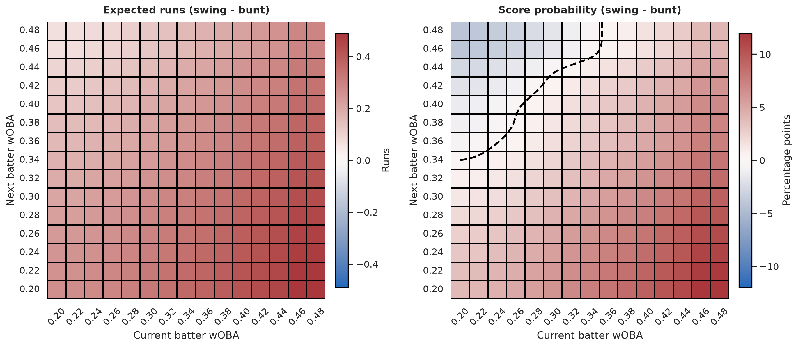
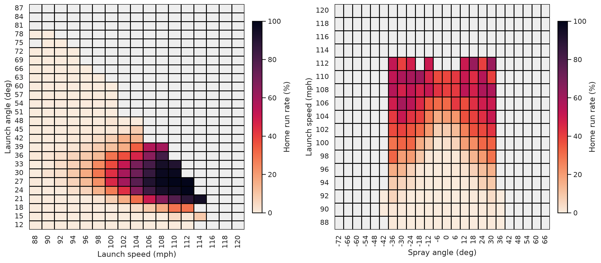
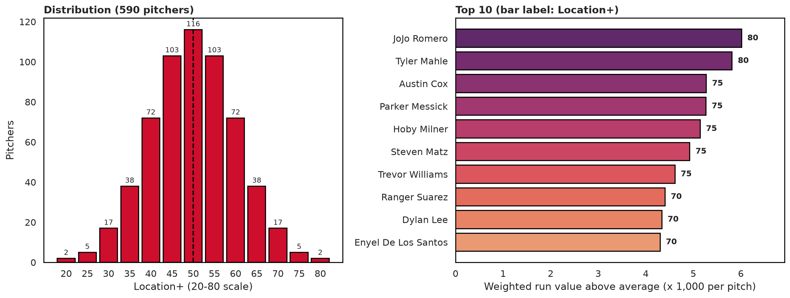

# Baseball Playground

**Baseball analytics built on 2025 MLB Statcast data: strategy evaluation, prediction and player metrics.**

Aspiring data scientist with experience developing performance metrics and evaluating players with Baseball Savant tracking data and statistical models. Each project below covers data collection, preprocessing, modeling and visualization, and runs end to end with one command.

## Projects

### Bunt Decision Analysis by Batting Order
**Should a team bunt with a runner on first and no outs? It depends on who bats now and who bats next, and on whether the goal is more runs or just one run.**

<p align="center">
  <a href="bunt-strategy-analysis"></a>
</p>

- Swinging away is better on expected runs in all 22,500 batter combinations.
- Bunting gives a higher probability of scoring in 16.8% of them, by up to 4.1 points when a weak hitter is followed by an elite one.
- Method: base-out transition tables, a wOBA kernel for outcome probabilities, and swing-versus-bunt comparison.

<sub>[Read more](bunt-strategy-analysis)</sub>

---

### Home Run Probability Model
**Which batted-ball features decide a home run? Logistic Regression, LightGBM and TabPFN compared on calibration and permutation importance.**

<p align="center">
  <a href="homerun-probability-model"></a>
</p>

- Non-linear models separate home runs far better than the logistic baseline.
- Launch speed and launch angle dominate; ballpark adds little.
- Method: home run candidate filtering, spray angle from field coordinates, Brier-score permutation importance.

<sub>[Read more](homerun-probability-model)</sub>

---

### Location+: A Pitcher Command Metric
**A 20-80 grade that rewards pitchers who both throw to valuable locations and repeat them.**

<p align="center">
  <a href="pitch-location-plus"></a>
</p>

- Out-of-fold XGBoost location value, weighted by a kernel-density consistency score.
- Validated with split-half reliability (Spearman-Brown) and a normality test on the final grades.
- Method: 590 qualified pitchers, rank-based rescaling to a 20-80 scale centered at 50.

<sub>[Read more](pitch-location-plus)</sub>

## Getting started

Every project is self-contained:

```bash
cd <project-folder>
pip install -r requirements.txt
python main.py
```

Pitch data are downloaded from Baseball Savant with [pybaseball](https://github.com/jldbc/pybaseball) on the first run and cached. Figures are written to each project's `figures/` folder.

```
Baseball_Playground/
├── bunt-strategy-analysis/
├── homerun-probability-model/
└── pitch-location-plus/
```

Each project has the same layout: `main.py` as the entry point, `src/` for configuration, preprocessing, modeling and visualization, and `figures/` for results.

## Tech stack

Python, pandas, NumPy, SciPy, scikit-learn, XGBoost, LightGBM, TabPFN, Matplotlib, Seaborn, [pybaseball](https://github.com/jldbc/pybaseball)
