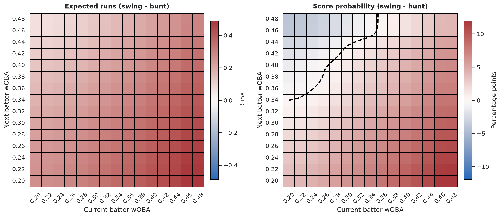
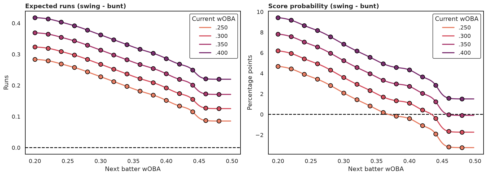
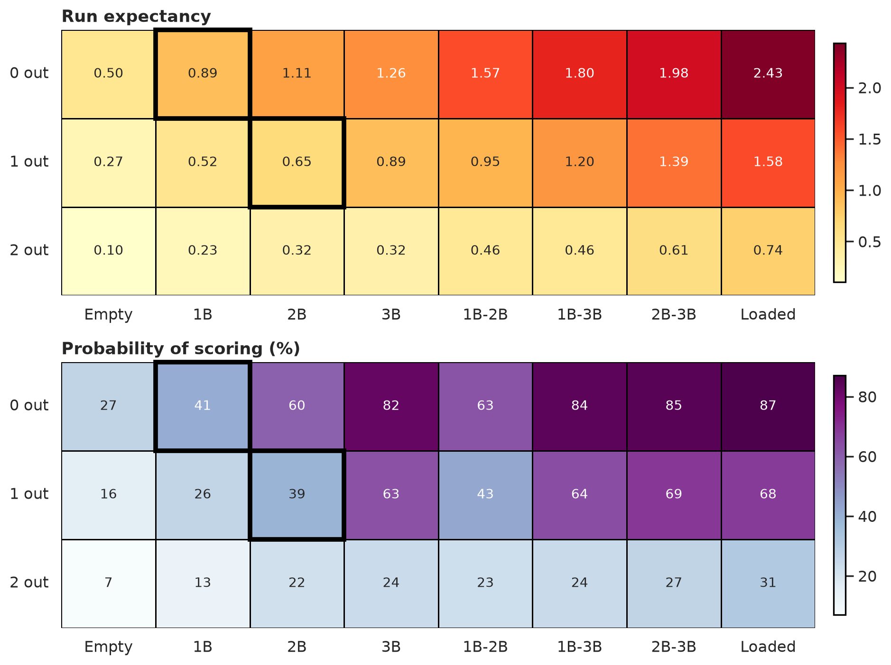
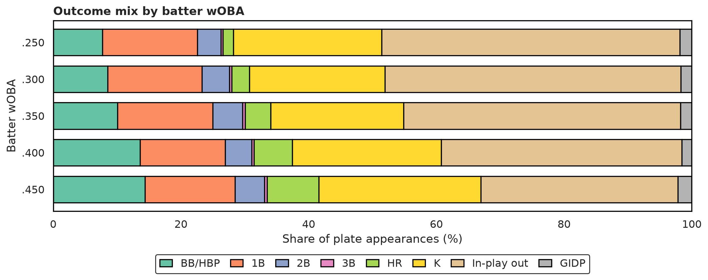

# Swing Away or Sacrifice Bunt?

**A batting-order view of the bunt decision with a runner on first and no outs, judged by expected runs and by the probability of scoring (2025 MLB regular season).**

<p align="center">
  
</p>

<p align="center"><sub>Red cells favor swinging away, blue cells favor a successful sacrifice bunt. The dashed line marks break-even.</sub></p>

## Key findings

| | Expected runs | Probability of scoring |
|---|---|---|
| Swing is better in | **100%** of 22,500 wOBA combinations | **83.2%** of combinations |
| Bunt is better in | none | **16.8%** — weak current batter, strong next batter |
| Largest gap | swing ahead by 0.07 to 0.49 runs | bunt ahead by up to **4.1 points** |

- **If the goal is to maximize runs, swing away.** Giving up an out is never repaid, even with a .200 hitter at the plate and a .498 hitter on deck.
- **If one run is all that matters, the answer depends on the lineup.** A .300 current batter is better off bunting once the next batter reaches .434 wOBA; a .250 batter, once the next one reaches .370. A .400 batter should always swing.
- **Example:** current batter .299, next batter .480. Swinging gives **+0.124 expected runs**, but bunting gives **+1.77 percentage points** of scoring probability.

<p align="center">
  
</p>

## Why it matters

Sabermetrics treats the sacrifice bunt as inefficient: trading an out for a base lowers expected runs on average. But that average hides the batting order. When a weak hitter is followed by an elite one, advancing the runner may be worth more than letting the weak hitter try to drive him in. This project quantifies where that happens, and shows that the answer changes with the goal — maximizing expected runs versus scoring at least once.

<p align="center">
  
</p>

<p align="center"><sub>Outlined cells: swinging starts from 0 out with a runner on 1B; a successful bunt moves to 1 out with a runner on 2B.</sub></p>

## How it works

1. **State tables.** From 2025 regular-season Statcast (2,430 games, 183,245 plate appearances), build the Run Expectancy matrix for the 24 base-out states and the probability of scoring at least one run from each state, plus the transition table from (state, outcome) to the end state.
2. **Batter quality as wOBA.** Compute each hitter's wOBA with 2025 FanGraphs weights, then estimate the outcome mix of a hitter at any wOBA by Gaussian-weighting the 277 hitters with at least 300 PA (bandwidth .015), following the strategy-evaluation framework of *The Book*. Outcomes are BB/HBP, single, double, triple, home run, strikeout, in-play out and double play.
3. **Swing versus bunt.** Swinging is the current batter hitting from 0 out with a runner on 1B. A successful bunt is assumed to produce 1 out with a runner on 2B, with the next batter hitting. Each outcome is valued by the end state it creates, and the two options are compared for every current/next wOBA pair from .200 to .498.

<p align="center">
  
</p>

## Run it

```bash
pip install -r requirements.txt
python main.py
```

Pitch data are downloaded once with `pybaseball` and cached. The four figures are written to `figures/`. Use `--start` and `--end` to change the date range.

```
bunt-strategy-analysis/
├── main.py                 # Pipeline entry point
├── src/
│   ├── config.py           # Constants: dates, event classes, wOBA weights, decision states
│   ├── preprocessing.py    # Statcast download, plate-appearance table, RE / scoring tables
│   ├── modeling.py         # wOBA kernel outcome model, swing versus bunt comparison
│   └── visualize.py        # Figures
└── figures/
```

## Limitations

- A bunt is assumed to succeed cleanly. Real bunts can fail, retire the lead runner, become hits or draw errors, so the true value of an attempt differs.
- Only the current and next batters are modeled; the rest of the lineup is folded into league-average run expectancy. Runner speed, defensive positioning and the pitcher are not considered.
- The 277 qualified hitters span .244 to .463 wOBA. Estimates near the edges of the grid, such as the flat region above .46, rest on very few hitters.
- Values are for the state "no outs, runner on first" only and ignore inning and score. A natural extension is win expectancy.

## Tech stack

Python, pandas, NumPy, Matplotlib, Seaborn, [pybaseball](https://github.com/jldbc/pybaseball) (Statcast)
