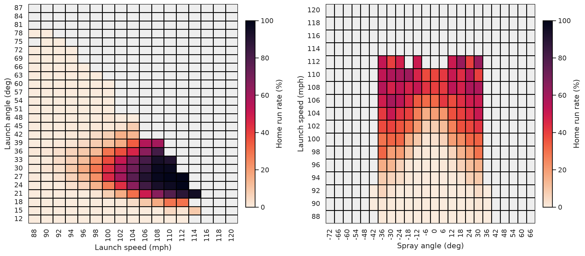
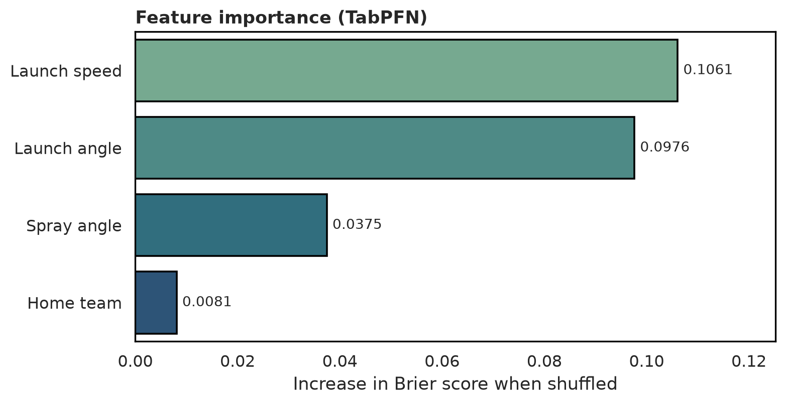
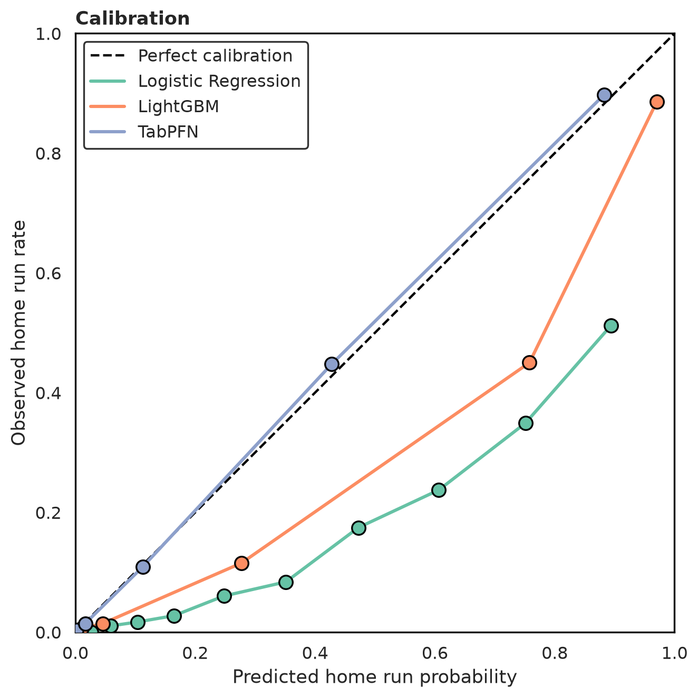

# What Makes a Home Run?

**A home run probability model built on 2025 MLB Statcast batted balls (regular season), and what its feature importance says about launch speed, launch angle, spray angle and ballpark.**

<p align="center">
  
</p>

<p align="center"><sub>Observed home run rate of home run candidate balls (38,107 balls, 5,616 home runs). Gray cells have fewer than 20 balls.</sub></p>

## Key findings

| Model | Test F1 | Precision | Recall |
|---|---|---|---|
| TabPFN (v3.5) | **0.793** | 0.813 | 0.774 |
| LightGBM | 0.783 | 0.814 | 0.754 |
| Logistic Regression | 0.502 | 0.410 | 0.649 |

<sub>Test set, F1-optimal threshold chosen on the validation set. Brier score: TabPFN 0.042, LightGBM 0.058, Logistic Regression 0.165.</sub>

- **Non-linear models separate home runs far better.** TabPFN and LightGBM reach F1 near 0.79 and 0.78, while Logistic Regression stays at 0.50.
- **Speed and angle decide it.** Shuffling launch speed or launch angle hurts the predicted probabilities most, spray angle comes next, and **home team adds little** — how hard and at what angle a ball is hit tells far more than which park it is hit in.
- **TabPFN is the best calibrated.** Its importances are launch speed 0.1061, launch angle 0.0976, spray angle 0.0375 and home team 0.0081.

<p align="center">
  
</p>

## Why this project

After reading Leo Breiman's *Statistical Modeling: The Two Cultures* in an introductory data science course, I wanted to see whether a high-performing algorithmic model can reveal the structure of data, not just predict it. I trained models to predict home runs from batted-ball features, then asked the best-calibrated model which features it relies on.

<p align="center">
  
  
</p>

<p align="center"><sub>Models trained with balanced class weights predict higher probabilities than the observed rate, so their curves sit below the diagonal. TabPFN's probabilities follow the diagonal most closely, which is why it is used for the importance analysis.</sub></p>

## How it works

1. **Data.** Regular-season (`game_type == "R"`) Statcast batted balls from 2025-03-18 to 2025-09-28 via `pybaseball`. A ball is a home run candidate when its launch speed and angle are at least the smallest values seen on an actual home run.
2. **Features.** Launch speed, launch angle, spray angle (computed from the field coordinates) and home team as a categorical variable for park effects.
3. **Models.** Logistic Regression as the baseline, LightGBM for non-linear relationships and TabPFN (v3.5), a Transformer-based foundation model for tabular data. The data is split 60/20/20 with the class ratio preserved, the F1-optimal threshold is chosen on the validation set, and the test set gives the final scores. Calibration curves check how well probabilities match actual rates.
4. **Importance.** Permutation importance: shuffle one feature at a time and measure the increase in Brier score. This works for models such as TabPFN that have no built-in importance.

## Run it

```bash
pip install -r requirements.txt
python main.py
```

Pitch data are downloaded once with `pybaseball` and cached, and the four figures are written to `figures/`. Without a token, Logistic Regression and LightGBM run and the importance uses LightGBM. To add TabPFN, install `tabpfn` and `torch`, then set the token (a GPU is recommended):

```bash
export TABPFN_TOKEN=your_token_here   # Windows PowerShell: $env:TABPFN_TOKEN="your_token_here"
```

```
homerun-probability-model/
├── main.py                 # Pipeline entry point
├── src/
│   ├── config.py           # Constants: dates, features, split settings
│   ├── preprocessing.py    # Statcast download, home run candidates, feature engineering
│   ├── modeling.py         # Models, evaluation, permutation importance
│   └── visualize.py        # Figures
└── figures/
```

## Limitations and next steps

- Park effects are reduced to one categorical variable (home team), which does not capture fence distance and height by direction, or temperature, humidity and wind.
- Park dimensions matter in practice: a study at the 2025 SABR Analytics Conference examined how changing ballpark dimensions could change a team's run scoring. Next, I plan to combine fence distance and height by direction with the batted-ball direction and add environmental variables, to model how the same batted ball's home run probability changes by park and conditions.
- TabPFN permutation importance is slow (about a day on a laptop GPU); lower the number of repeats or the sample size to speed it up.

## Tech stack

Python, pandas, NumPy, scikit-learn, LightGBM, TabPFN, Matplotlib, Seaborn, [pybaseball](https://github.com/jldbc/pybaseball)
