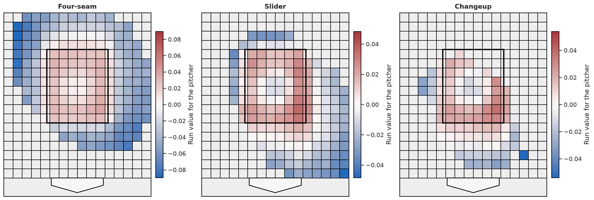
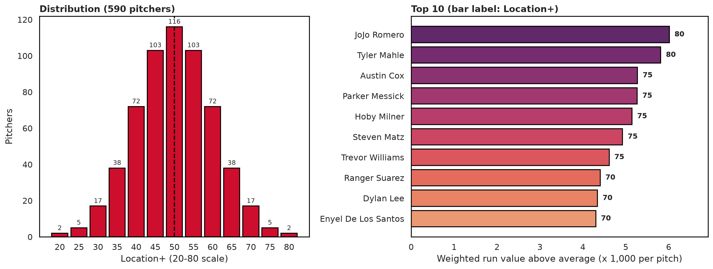
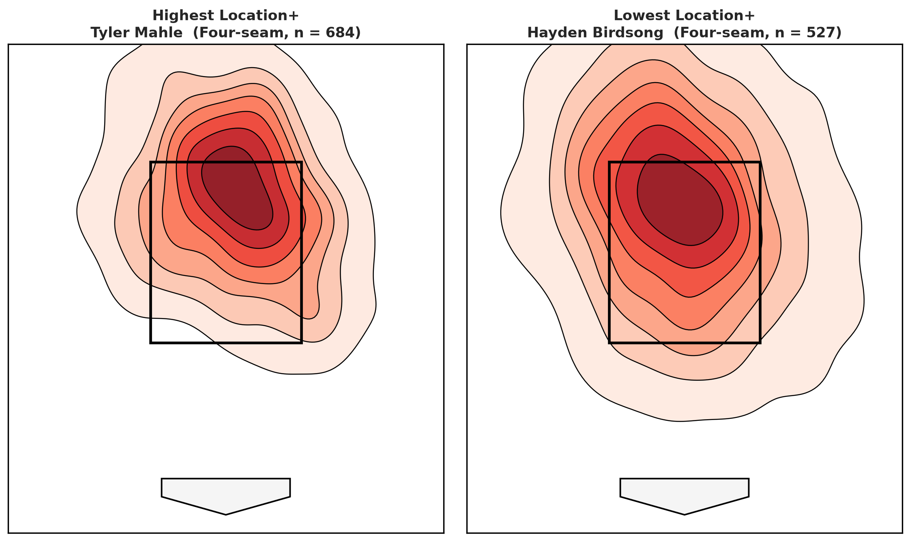
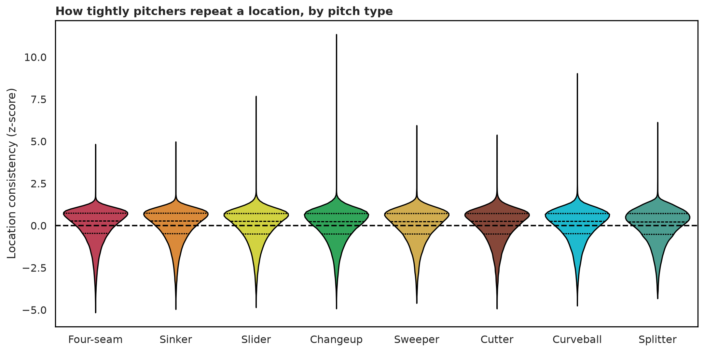
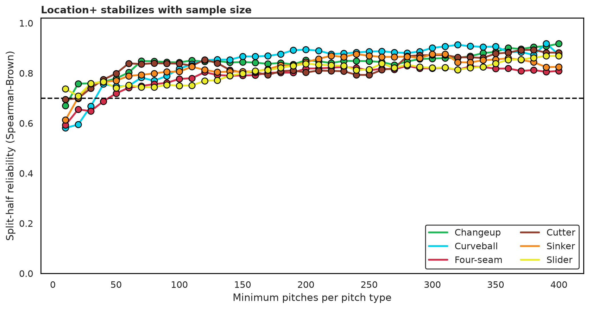

# Location+

**A pitcher command metric that combines how valuable a pitch location is with how consistently it is repeated, graded on the 20-80 scouting scale (2025 MLB regular season).**

<p align="center">
  
</p>

<p align="center"><sub>Mean predicted run value of a pitch by location (right-handed pitcher vs right-handed batter, catcher's view). Red is good for the pitcher, blue is bad.</sub></p>

## Key findings

- **590 pitchers** qualified (at least 60 pitches per pitch type, on at least half of their pitch types).
- **Top grades:** JoJo Romero and Tyler Mahle earn **80**; Austin Cox, Parker Messick, Hoby Milner, Steven Matz and Trevor Williams earn **75**.
- **Reliable with modest samples.** Split-half reliability passes 0.7 by about 50 pitches per pitch type for the six main pitches, which supports the 60-pitch cutoff.
- **A sound grade scale.** The final distribution is centered at 50 with a standard deviation of 10, and a D'Agostino K² test does not reject normality (p = 0.596).

<p align="center">
  
</p>

## What it measures

Command is usually judged by outcomes such as BB%, or by models that guess the pitcher's intended target. Public data cannot show intent, so Location+ defines command as *"the ability to consistently throw to locations that are difficult for hitters to attack"* and measures two things:

1. **Location value:** how good the place a pitch ends up is for the pitcher.
2. **Repeatability:** how tightly the pitcher groups that pitch type.

A pitcher is rewarded for repeating good locations and penalized more for repeating poor ones.

<p align="center">
  
</p>

<p align="center"><sub>Four-seam fastball locations of the highest and the lowest Location+ pitcher with at least 400 four-seamers: a tight cluster versus a wide spread.</sub></p>

## How it works

1. **Location value.** An XGBoost regression predicts the pitcher-perspective run value (`delta_pitcher_run_exp`) from the location (`plate_x`, `plate_z`), pitch type, count and batter and pitcher handedness. Five-fold out-of-fold prediction means each pitch is scored by a model that never saw it.
2. **Consistency.** For each pitcher, pitch type and batter side, a 2D Gaussian kernel density gives every pitch a log-density score. Scores are standardized by pitch type, so a value above 0 means tighter than the league average for that pitch.
3. **Combine.** The z-score becomes a percentile and a weight of `2 x CDF(z)` (clipped to 0.1-2.0) that multiplies the location value.
4. **Grade.** Each pitch type is compared with its league average and averaged by pitch count. The pitcher-level value is ranked, mapped to a normal quantile and rescaled to a 20-80 grade centered at 50.
5. **Reliability.** Pitches of the same pitcher and pitch type are split into odd and even sequences, and the Spearman-Brown corrected correlation of the two halves shows when the metric stabilizes.

<p align="center">
  
  
</p>

## Run it

```bash
pip install -r requirements.txt
python main.py
```

Pitch data are downloaded once with `pybaseball` and cached, and the six figures are written to `figures/`.

```
pitch-location-plus/
├── main.py                 # Pipeline entry point
├── src/
│   ├── config.py           # Constants: dates, features, model and threshold settings
│   ├── preprocessing.py    # Statcast download, count and target variable engineering
│   ├── modeling.py         # OOF XGBoost, KDE consistency, reliability, Location+ grade
│   └── visualize.py        # Figures
└── figures/
```

## Limitations and next steps

- Location+ does not measure the intended target, so it is closer to the value and repeatability of actual locations than to command in the traditional sense. A pitcher who spreads a pitch across locations on purpose can score as less consistent.
- The location value model ignores velocity, movement, release point and batter traits. Adding stuff variables would separate a good location produced by good stuff from a pitch that is good because of where it went.
- With catcher target or sign data, Location+ could add intent-versus-execution error and become a more direct command metric.

## Tech stack

Python, pandas, NumPy, SciPy, scikit-learn, XGBoost, Seaborn, Matplotlib, [pybaseball](https://github.com/jldbc/pybaseball)
